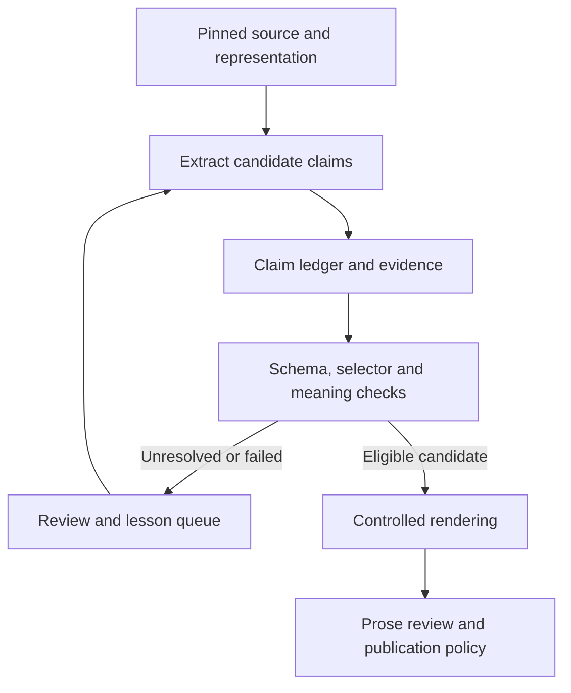

# Implementing CivicSpec Controlled English

Use `civicspec-controlled-english/0.1-draft.3` as an explicitly enabled experimental profile. Keep the existing collector, source store, queue, and publishing policy. The code in this package is a reference evaluation harness and a preservation guard, not a production extractor.

## Integration boundary



An evidence hash establishes byte identity. A selector check establishes the selected text. A ledger-preservation check establishes equality of specified fields. An action-pattern match proposes a category. None of these independently proves the civic interpretation.

## Ordered implementation work

| Step | Implement | Exit evidence |
| --- | --- | --- |
| 1 Pin | Resolve an authorized release; record language/profile, schema, adapter and model/prompt versions | Adoption receipt with manifest and component digests |
| 2 Map | Map current assertions to the experimental ledger without replacing production IDs | Field mapping; explicit unsupported dimensions; no silent defaults |
| 3 Segment | Separate actor turns, agenda matters, treatments, votes and conditions | Two motions remain distinct; one batch motion can retain multiple targets |
| 4 Extract | Produce candidate claims with evidence and unresolved fields before prose | Source, selector, actor/capacity, modality, outcome and scope are populated or explicitly unresolved |
| 5 Validate | Run structure, references, selectors, semantic rules, then rendering checks | Distinct results for each layer; rejected cases retained for review |
| 6 Render | Generate readable prose from the validated candidate ledger | Every consequential clause maps to a claim ID; qualifiers remain visible |
| 7 Compare | Run existing behavior and candidate behavior on the same pinned sources | Paired diffs, unsupported promotions, abstention, completeness and cost |
| 8 Adopt | Enable only the reviewed source/body cohort and permitted use | Accountable decision, monitoring, rollback and impact query |

The reference scalar classifier is suitable for diagnostic comparison. It does not perform Step 3, determine legal effect, verify votes, or establish financial execution. Its known failures block automatic fact promotion.

## Required runtime checks

1. Validate the source ID, source digest, representation and selector before reading an interpretation as evidence.
2. Check the claim's actor and capacity against its source context. Retain competing body labels until resolved.
3. Require treatment-to-vote links. Detect multiple treatments before choosing a single action label.
4. Bind polarity, conditions, amounts and time to the specific claim they qualify.
5. Treat future discussion separately from formal motions and recorded outcomes. Check both lexical markers and event context.
6. Preserve `source_reported` attribution through every summary. Promotion to a reviewed finding requires its own review event.
7. Run `cce_typed_guard.validate_typed_rewrite(original, candidate, 'v3')` for a wording-only transformation. This implementation preserves JSON types as well as values. A semantic correction uses a new claim version.
8. Review free prose against the ledger. The current guard intentionally ignores `wording` and cannot validate that prose.

Production adapters need typed, claim-level condition expressions, evidence per amount and qualifier, controlled predicate definitions, and reversible identity resolution. The evaluation ledger's coarse dictionaries and occasional mixed-modality records are not the finished implementation of those requirements.

Implementation `cce-preservation-guard/1.1` was added during final review after the frozen corpus study. It closes Python's boolean/number equality ambiguity; the original frozen guard remains available for historical replay. Its separate qualification replays the same 803 mutations and adds four synthetic type substitutions. Type equality still does not establish the truth of either ledger or the fidelity of free prose.

## Reproduce the executed tests

From the CivicSpec directory, with `requirements-dev.txt` installed:

```sh
python scripts/cce_lint.py
python scripts/cce_backtest.py --output /tmp/cce-preservation.json
python -m unittest discover -s tests -v
```

The offline backtest executes the preservation tests. It does not silently replay stored action predictions as if it had rerun extraction.

To reconstruct the action inputs from the public source locations, install the optional pinned PDF dependency and choose a cache outside the repository:

```sh
python -m pip install -r requirements-corpus.txt
python scripts/cce_fetch.py --allow-network --cache-dir /tmp/cce-source-cache --text-cache /tmp/cce-texts.json --receipt /tmp/cce-source-receipt.json
python scripts/cce_backtest.py --text-cache /tmp/cce-texts.json --output /tmp/cce-reproduced-results.json
```

Network access is explicit. The fetcher verifies all source hashes and selected-text hashes. A changed endpoint, changed PDF extraction, missing source, or altered selector fails the replay instead of silently substituting a new corpus. Use an authorized retained snapshot when a source has changed. Do not publish the downloaded source archive merely to make replay easier.

## Bot-farm model experiment still required

The executed study made zero independent model calls. It cannot establish the causal effect of STE-style prompting. Use the [model-study protocol](../evaluations/controlled-english-2026-10-10/model-study.json) and [bootstrap instructions](../bootstrap/controlled-english.md) for the next experiment.

Compare three arms on the same newly sampled, source-pinned inputs:

- **A:** Existing CivicSpec instructions and existing output behavior.
- **B:** Existing semantic requirements plus controlled wording/terminology, with no new validator. This tests the language contribution.
- **C:** The integrated profile, structured ledger, and separately recorded validation results. This tests the combination.

Hold model/version, tools, source access, output budget, temperature and decoding settings constant where supported. Counterbalance order and use independent sessions. Record prompt lengths, input/output tokens, latency, retries and model cost; the integrated arm may use more tokens. Separate first-pass correctness from correctness after retries or review. Store actual raw outputs and configuration digests.

Use source-separated development, validation and final holdout groups. All 60 cases in this package are now public teaching/regression material. They are unsuitable as an unseen benchmark for an agent that has loaded the package. Independent reviewers should label the new sample without seeing candidate outputs, retain disagreements, and adjudicate consequential cases. Where two reviewers cannot be obtained, report the single-reviewer limitation.

Score claim precision, unsupported promotion, missing treatments, condition/negation loss, quantity and time errors, evidence resolution, abstention, coverage, review burden and resource use separately. Include ordinary easy passages and hard passages; do not construct a sample entirely from failures or keyword matches. Keep metrics clustered by meeting/body, and report counts before percentages. A small holdout does not justify a production reliability percentage.

## Learning without definition drift

Capture a lesson when a checker fails, reviewers disagree, a new phrase is unmapped, or a published interpretation needs correction. The lesson includes the exact source span, observed output, expected behavior, rule/profile versions, likely cause, proposed scope, counterexamples, and an impact query.

For a scalar classification failure, the impact query should select claims produced by the affected classifier/prompt version whose evidence contains multiple treatments or prospective language. Do not refresh the entire corpus merely because a phrase rule changed. For a vocabulary definition change, query all dependent predicates and downstream answers, not just matching text.

An agent may propose a local alias or adapter. It must not redefine a shared term through repeated use. Maintain the difference between an editorial clarification, an extraction rule, a semantic change, and a corrected civic claim. Each needs its applicable review and version history. A formerly reserved example becomes regression material immediately after it influences a change.

## Immediate open work

| Failure or gap | Next implementation | Acceptance evidence |
| --- | --- | --- |
| J021: minutes noun precedes approval request | Context-aware motion resolution | Correct action with the later environmental letter kept separate |
| J032: future hearing intention becomes action | Explicit modality/state extraction before classification | No operative scheduling assertion until a motion or later decision is supported |
| J061: minutes, corrections and abstracts collapse | Event/treatment segmentation with correction links | Every motion and corrected amount retains its scope and date |
| Coarse nested dictionaries | Typed production envelope and condition expressions | Nested mutation tests, unknown-state tests, schema migration |
| Free prose can contradict a correct ledger | Constrained rendering or independent semantic review | Adversarial prose changes rejected with clause-to-claim traceability |
| Labels from one assistant | Independent civic annotation and adjudication | Published label provenance, disagreements and resolved review history |
| Missing original-audio checks | Targeted audio/official-record verification | Corrected ASR identifiers, quantities and vote boundaries with provenance |

Rollback restores the prior approved profile for new work, retains historical receipts, and queues affected outputs for review. The release candidate does not authorize production corpus mutation or automatic publication of civic conclusions.
