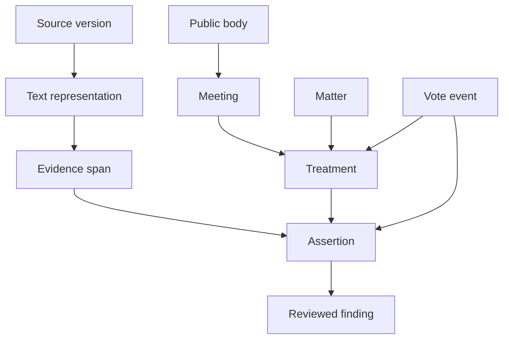

# Concepts and relationships

CivicSpec is a proposed shared model for civic evidence and interpretation. Its core unit is an attributed, source-backed assertion in context. Applications can project those assertions into meeting summaries, matter timelines, finance analysis, coverage reports, or research questions.

## Objects that must stay distinct

| Object | Meaning | Common mistake to avoid |
| --- | --- | --- |
| Government / jurisdiction | A governmental entity and the scope in which it has authority | Treating a town, school district, and similarly named place as identical |
| Public body / capacity | The board, committee, office, or other actor, with time-qualified authority | Assuming geographic overlap establishes organizational parentage |
| Meeting / session | A gathering of a particular body in a particular context | Using municipality plus date as a globally unique key |
| Recording / document version | A source representation of activity, with its own history and digest | Treating two recordings as two meetings or a revised PDF as unchanged |
| Matter | The substantive item that may recur across meetings | Treating agenda position 7 as a durable matter identifier |
| Treatment | A motion, amendment, procedural step, or consideration of a matter | Collapsing an agenda-inclusion motion and final passage |
| Vote event | A particular vote deciding a particular treatment | Attaching one vote to every action near it in the text |
| Assertion | A subject, predicate, typed value, context, evidence, interpretation, and review state | Equating a source statement with independently established truth |
| Source version / evidence span | Pinned bytes and a reproducible selection in a named representation | Calling an ASR-text digest the digest of original audio |
| Financial observation | An amount with entity, period, role, basis, unit, and source | Adding authorization, proceeds, and expenditure as if all were spending |
| Condition / obligation | A trigger, dependency, or required act with scope and authority | Assuming conditional approval means its conditions occurred |
| Lesson / change proposal | An observed failure and a proposed, reviewable response | Letting one extraction silently rewrite shared definitions |

The arrows illustrate relationships, not a requirement for separate services or a complete RDF vocabulary. A finding retains the assertions and evidence it depends on. Disagreement and corrections remain visible.

## Layers

The research baseline separates evidence; document structure; government/body/capacity; procedure; money/projects/obligations; assertions and review; questions; and legal applicability. [The retained layer definitions](../research/2026-09-07/ontology/layers.json) describe their original research scope. Historical implementation-status strings in those files are not promises about this toolkit.

## Assertion meaning

The adoption contract requires identity, typed value, context, attribution, polarity, modality, conditions, time, evidence, interpretation versions, review, lineage, and publication scope. [Section 11](specification.md#11-assertion-and-event-contracts) gives the logical contract. The [fixture schema](../schemas/assertion-fixture.schema.json) validates a deliberately narrower synthetic teaching representation.

`source_reported` means a statement is attributed to a source. It does not mean the physical event was independently verified. `candidate` is a review state, not a confidence score. An `ext:` predicate in an example is a proposed extension, not an accepted term in every CivicSpec profile.

## Identity and time

Keep existing producer identifiers as aliases. Resolve identities through evidence, scope, and reversible decisions. Distinguish event time, effective time, source publication time, retrieval time, and interpretation time. Record unknowns explicitly. Later knowledge must not silently overwrite what a past source or past analysis said.

## Questions drive useful modeling

A model is useful when it can answer a concrete question with evidence or explain why it cannot. For example: which motion did the vote decide; which grant conditions remain open; which evidence establishes expenditure; which source revision changed the answer; which municipalities are comparable under the same definitions and coverage?

The [research question definitions](../research/2026-09-07/ontology/question-definitions.json) are historical seeds. Community contributions should bring new source patterns, counterexamples, and answerability tests.
